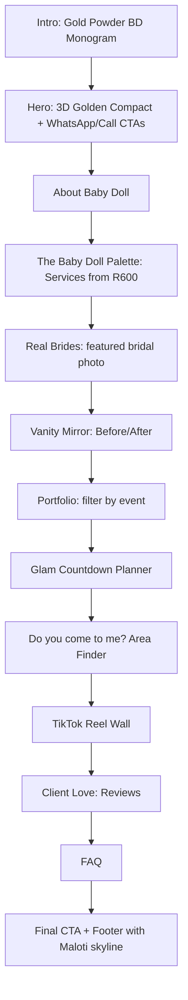

# Baby Doll: Premium Make-up Artistry Website (Qwa Qwa / Phuthaditjhaba)

**Project folder:** `/Users/montyrethabilemahlatsi/.gemini/antigravity/scratch/mua-qwaqwa/`
**Stack:** Static HTML + modern CSS + vanilla JS, with **Three.js** (loaded only when needed) for light 3D. Hosting is free on Cloudflare Pages or Netlify, and a `.co.za` domain can be added.
**Approach:** Mobile first. Fast on prepaid mobile data. Every screen has a quick way to WhatsApp or call.

## Confirmed Business Details
| Item | Value |
|---|---|
| Brand | **Baby Doll** (monogram **"BD"**) |
| Tagline (draft) | *"Flawless for every occasion."* |
| Phone / WhatsApp | `081 234 5678` → `tel:+27812345678` · `https://wa.me/27812345678` |
| TikTok | `@babydoll.glam.qwaqwa` (stand-in handle, easy to replace in `config.js`) |
| Pricing | **Glam from R600**. Each service card shows "From R600", and the final quote is given on WhatsApp |

### Photos
The uploaded bridal photo is the **main real photo**. It will be used for:
- The **Bridal & Traditional Wedding** service card and the first portfolio image
- A full-screen **"Real Brides" feature** with gold-frame styling (the gold tones of the shweshwe fabric and pearls suit the palette well)
- The link preview image when the site is shared on WhatsApp

AI-generated placeholders will cover the other services (matric farewell, birthdays, photoshoots, before/after) until real photos are available.


---

## 1. Brand Direction: "Baby Doll × Gold Hour in the Maloti"

Black and brushed gold for luxury, with small local touches: the outline of the Maloti mountains around Qwa Qwa and geometric patterns inspired by the Basotho blanket (Seanamarena). The site should feel high-end and also clearly from Qwa Qwa. For the **"Baby Doll"** name, a soft blush accent and porcelain-smooth finishes add a feminine, doll-like touch, kept elegant rather than childish.

### Colour palette
| Role | Name | Hex |
|---|---|---|
| Base background | Onyx Black | `#0B0B0C` |
| Raised surfaces | Velvet Charcoal | `#16151A` |
| Primary accent | Brushed Gold | `#C9A961` |
| Gold highlight / foil shine | Champagne | `#E8D9B5` |
| Deep gold / borders | Antique Brass | `#8C6A32` |
| Romantic accent (bridal) | Rose Nude | `#C99A8B` |
| "Baby Doll" accent (small details only) | Porcelain Blush | `#E9C6C0` |
| Rich accent (sparingly) | Oxblood | `#4A0E1A` |
| Light text / light sections | Ivory | `#F6F1E7` |

### Typography
- **Headings:** *Cormorant Garamond* (an elegant editorial serif, used in italics for emphasis)
- **Body/UI:** *Manrope* (clean and readable on small screens)
- Fonts are self-hosted and subset to keep downloads small.

### Visual motifs
- A brushed-gold foil gradient on headings that shimmers slowly
- Fine gold hairline borders, plus a film-grain overlay for a "luxury print" texture
- Maloti mountain line art as section dividers, with gentle parallax
- Small Seanamarena-inspired geometric patterns in corners and dividers (never loud)

---

## 2. Signature Features (what makes it different)

| # | Feature | What the visitor experiences |
|---|---|---|
| 1 | **The Golden Compact (3D hero)** | A black-and-gold make-up compact with a **"BD" monogram engraved** on the lid floats in 3D, turning slowly as gold dust drifts around it. Scrolling opens the lid, and the mirror shows *"Baby Doll · Flawless for every occasion"*. On phones it tilts when the user tilts the phone. Built from simple shapes in code, with no heavy 3D model files. |
| 2 | **Lipstick Scroll Meter** | A thin gold lipstick sits on the screen edge, and its bullet twists up as you scroll down the page. It replaces the boring progress bar. |
| 3 | **Vanity Mirror Before/After** | Before/after photos sit inside a Hollywood vanity mirror. Dragging the slider turns on the bulbs around the frame one by one, so the photo "gets ready" as the lights come on. |
| 4 | **The Palette (Services)** | Services are shown as an eyeshadow palette (a "Baby Doll Palette"). Each pan is a service with its own shimmer colour. Tapping a pan opens a card with **"From R600"**, what's included, duration, and a **Book this look on WhatsApp** button. |
| 5 | **Glam Countdown Planner** | The visitor picks an event type, date, number of faces, and area. The site then (a) builds a personal prep timeline (e.g. "3 weeks before: trial", "1 week before: skin prep"), (b) shows an estimate starting from R600 per face, and (c) creates a **ready-to-send WhatsApp message** with all the details. This removes the back-and-forth and leads straight to bookings. |
| 6 | **"Do you come to me?" Area Finder** | A gold line map of Phuthaditjhaba and surrounding areas. Tap your area to see whether a travel fee applies, then message on WhatsApp. |
| 7 | **Gold Powder Intro** | A short (under 1.2 s) intro where gold powder gathers into the **"BD" monogram**, followed by "Baby Doll". It plays only on the first visit and can be skipped. |
| 8 | **Sesotho touches** | Small greetings in the copy, e.g. "Dumela, motswalle" and "Re a leboha" ("thank you") on the success messages. |
| 9 | **TikTok Reel Wall** | A row of portrait cards styled like TikTok videos, linking to `@babydoll.glam.qwaqwa`. Videos play only when tapped (saves mobile data). |

---

## 3. Easy WhatsApp and Calls (conversion design)

- **Sticky bottom action bar** (always within thumb reach on mobile): `WhatsApp` · `Call` · `Book`
  - WhatsApp: `https://wa.me/27812345678?text=<pre-filled message>`
  - Call: `tel:+27812345678` (shown as **081 234 5678**)
- **Every service card, gallery look, and planner result** has a WhatsApp button with a **pre-filled message for that context**, e.g. *"Dumela Baby Doll! I'd love to book the Bridal Glam for 14 Dec in Phuthaditjhaba, 3 faces."*
- A floating WhatsApp button appears on desktop.
- A **link preview image** (Open Graph) so the site looks premium when shared in WhatsApp groups. This matters a lot locally.
- QR code download (for business cards and salon posters) that links to the site or WhatsApp.

---

## 4. Site Structure (single page, mobile first)



### Services (all "From R600", final quote on WhatsApp)
- Bridal & Wedding Glam (with optional trial)
- Bridesmaids & Bridal Party
- Traditional Ceremonies (Lobola, Magadi, Umembeso, Mokete)
- Matric Farewell & Graduation
- Birthdays, Baby Showers & Parties
- Photoshoot & Editorial
- Soft Glam / Everyday Glam
- Mobile Service (travels to client)

### Service areas (draft)
Phuthaditjhaba, Witsieshoek, Tseki, Makwane, Monontsha, Bluegumbosch, Namahadi, Kestell, Harrismith, Bethlehem, Clarens, and nearby areas.

---

## 5. Project Structure

```
mua-qwaqwa/
├── index.html
├── css/
│   ├── tokens.css        # colours, fonts, spacing
│   ├── base.css          # reset, typography, grain, foil text
│   ├── components.css    # buttons, action bar, palette, mirror, cards
│   └── sections.css
├── js/
│   ├── main.js           # setup, lipstick scroll meter, reveals
│   ├── hero3d.js         # Three.js Golden Compact (loaded on demand)
│   ├── mirror.js         # before/after slider + bulbs
│   ├── palette.js        # services
│   ├── planner.js        # Glam Countdown + WhatsApp message builder
│   ├── areas.js          # area finder
│   └── config.js         # name, numbers, prices, areas (one place to edit)
├── assets/
│   ├── img/              # AVIF/WebP, several sizes
│   ├── fonts/
│   └── svg/              # monogram, Maloti line art, patterns
├── manifest.webmanifest  # "Add to Home Screen" support
└── README.md
```

> [!TIP]
> All business details (numbers, prices, areas, services) live in **`config.js`**, so they can be updated without touching the design.

---

## 6. Performance and Quality (important for mobile data)

- **Under 500 KB before the 3D loads.** Three.js loads only after the page is visible, and only on capable devices.
- **Fallbacks:** if the user prefers reduced motion, or the device has low memory or a weak GPU, the 3D compact is replaced by a still, high-quality image of the compact with a CSS shimmer.
- 3D pauses when it's off-screen or the browser tab is hidden (saves battery).
- Images use responsive AVIF/WebP and lazy loading. The hero image loads first.
- Modern CSS where browsers support it (scroll-driven animations, View Transitions for the gallery filters), with simple fallbacks where they don't.
- Accessibility: good colour contrast for gold on black, tap targets of at least 44 px, keyboard support, alt text.
- Targets: Lighthouse score of 90+ on mobile, LCP under 2.5 s on 4G.

## 7. Local SEO

- `schema.org` business markup (`BeautySalon` / `HealthAndBeautyBusiness`) listing the areas served
- Target searches: "makeup artist Qwa Qwa", "makeup artist Phuthaditjhaba", "bridal makeup Free State", "matric farewell makeup Qwa Qwa"
- Recommend setting up a **Google Business Profile** and linking it to the site
- POPIA-friendly: no tracking cookies by default, and the planner sends nothing to a server (it only builds a WhatsApp message)

---

## 8. Build Phases

| Phase | Work |
|---|---|
| 1 | Folder setup, colour/font settings, base styles, sticky WhatsApp/Call bar |
| 2 | All sections laid out mobile first, plus generated placeholder images |
| 3 | Signature features: Palette, Vanity Mirror, Lipstick Meter, Planner, Area Finder |
| 4 | 3D Golden Compact hero + gold powder intro + fallbacks |
| 5 | SEO, link preview image, add-to-home-screen support, accessibility and performance pass |
| 6 | Testing and deployment guide |

## 9. Verification Plan

- Test in the browser at 360 px, 390 px, 768 px and 1440 px widths
- Check that every `wa.me` and `tel:` link opens correctly with the right pre-filled text
- Run Lighthouse (performance, accessibility, SEO) on mobile settings
- Turn on reduced motion and check the 3D fallback
- Share the link to check the WhatsApp preview

---

## Open Questions (optional; sensible defaults will be used)

1. **Travel fee** for areas outside Phuthaditjhaba? *Default: "Travel fee may apply, ask on WhatsApp."*
2. Should Baby Doll's **own photo** go in the About section? *Default: an elegant AI-generated placeholder.*
3. **Domain**? *Suggested: `babydollglam.co.za`.*
4. Is **081 234 5678** a placeholder too? *Default: used as given and kept in `config.js` for easy replacement.*
